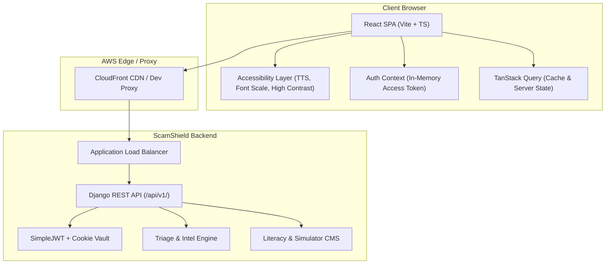

# Frontend Project Flow & Architecture

## 1. High-Level Architecture Overview

ScamShield Cloud is a single-page application (SPA) built with **React 18**, **TypeScript (Strict)**, **Vite**, **Tailwind CSS**, **TanStack Query (React Query)**, **Axios**, and **React Router DOM v6**.

The frontend interacts with the Django REST API backend via `/api/v1/` routes. In development, the Vite dev server proxies `/api` directly to `http://127.0.0.1:8000` (avoiding IPv6 localhost resolution latency). In production, AWS CloudFront delivers the compiled SPA assets from private S3 and routes API traffic directly to the Application Load Balancer (ALB).



---

## 2. User Personas & Permissions

The application supports four user roles with strict boundary enforcement:

| Role | Target Persona | Primary Responsibilities & Permissions |
|---|---|---|
| **Public / Anonymous** | General Citizen | Verify phone/URL/bank indicators; submit confidential reports; track report status; read educational guides; play simulator training. |
| **CITIZEN** (Logged In) | Registered Citizen | Submit authenticated reports; view submission history (`/reports/mine/`); manage threat alert subscriptions. |
| **ANALYST** (Staff) | Law Enforcement / Fraud Investigator | Access Triage Workbench (`/triage`); inspect pending incident clusters; download 15-minute presigned evidence; verify or reject malicious indicators. |
| **EDUCATOR** (Staff) | Security Awareness Educator | Author educational guides and anti-phishing training scenarios in Literacy Studio (`/studio`); upload media assets. |
| **ADMIN** (Staff) | System Administrator | Review and approve/reject staff applications (`/admin/users`); configure heuristic scanner rules; inspect system audit logs and CloudWatch operational metrics. |

---

## 3. End-to-End User Journeys

### 3.1 Citizen Journey: Threat Lookup (`/lookup`)
1. User enters an unformatted indicator (e.g., `+6012-345-6789`, `http://bank-login.xyz`, or bank account digits).
2. Frontend queries `POST /api/v1/lookups/`.
3. Backend auto-detects candidate indicator type and returns a clear verdict:
   - **RED:** Confirmed scam indicator with verified incident reports.
   - **YELLOW:** Suspicious activity or pending heuristic scan red flags.
   - **GREEN:** No known threat records in intelligence database.
4. Response displays plain-language recommendations and a 1-click shortcut to report an incident if they have been targeted.

### 3.2 Citizen Journey: Incident Submission & Recovery Playbook (`/report`)
1. User completes a guided multi-step incident report:
   - Step 1: Scam category (Phishing, Investment, E-commerce, Impersonation, etc.) and platform.
   - Step 2: Offender contact details (phone, URL, email, bank account).
   - Step 3: Financial loss and payment method.
   - Step 4: Narrative description and optional evidence file upload (max 3 files, PNG/JPEG/PDF <= 5MB).
   - Step 5: Anonymous toggle (default: linked to account if logged in, or purely anonymous).
2. On submit (`POST /api/v1/reports/`):
   - Anonymous submissions receive an 8-character Crockford base32 reference code (e.g., `SCM-2026-X7K9P2M4`) and a one-time 128-bit `access_key`.
   - The immediate response renders a personalized **Recovery Playbook** detailing emergency bank-freeze steps, official reporting hotlines, and credential reset instructions.
3. User can revisit `/report/track/` at any time to check report status using their reference code and access key.

### 3.3 Citizen Journey: Spot the Scam Simulator (`/simulator`)
1. User initiates a simulation session (`POST /api/v1/simulator/attempts/`).
2. Backend anti-cheat engine returns 5 random real-world scenarios with answer keys and red-flag coordinates masked.
3. User analyzes each scenario, toggles scam verdict, and identifies psychological tactics (Urgency, Authority, Fear, Greed, Familiarity, Isolation).
4. On completion (`POST /api/v1/simulator/attempts/{id}/complete/`):
   - Calculates score percentage and breakdown.
   - Highlights personal blind spots (tactics missed >= 2 times).
   - Dynamically recommends relevant remediation guides from the Literacy Hub.

### 3.4 Staff Journey: Analyst Triage Workbench (`/triage`)
1. Analyst logs in; `RequireRole` validates `ANALYST` or `ADMIN`.
2. Triage queue lists pending reports sorted by risk score and indicator cluster size.
3. Analyst inspects a report:
   - Views AI heuristic scan breakdown and related victim narrative clusters.
   - Requests presigned S3 URLs (`/triage/reports/{id}/evidence/`) for evidence inspection (URLs expire after 900 seconds with attachment headers).
   - Executes multi-report verification (`POST /triage/reports/{id}/verify/`) with threat level assignment, or rejects frivolous reports with mandatory justification.

### 3.5 Staff Journey: Educator Literacy Studio (`/studio`)
1. Educator accesses authoring dashboard.
2. Creates and edits rich markdown guides tailored to specific audience groups (`ELDERLY`, `TEENAGER`, `NON_TECH`, `GENERAL`).
3. Uploads verified multimedia assets (infographics, warning posters, audio explainers) stored in private S3 media buckets.
4. Submits guides for publication; publishing stamps immutable `published_at` date and updates public literacy catalog.

### 3.6 Staff Journey: Admin Console (`/admin`)
1. Review pending staff access requests; approve or reject with reasons.
2. Manage heuristic scanner keywords, TLD weights, and URL shortener rules; any change automatically increments global ruleset version and records an audit log.
3. Inspect operational telemetry and CloudWatch system health graphs.

---

## 4. Route Topology & Access Matrix

```
/ (PublicLayout)
├── / (Home)
├── /lookup (Threat Intelligence Lookup)
├── /report (Incident Reporting Wizard)
├── /report/track (Track Incident Status)
├── /literacy (Educational Hub)
├── /literacy/:slug (Guide Detail Reader)
├── /simulator (Interactive Anti-Scam Training)
├── /login (User & Staff Sign In)
├── /register (Citizen Registration)
├── /register/staff (Staff Application)
├── /unauthorized (403 Clearance Error)
└── * (404 Not Found)

/ (StaffLayout — Protected with RequireRole)
├── /triage (Analyst Workbench Queue — ANALYST, ADMIN)
├── /triage/reports/:id (Analyst Report Cluster Detail — ANALYST, ADMIN)
├── /studio (Educator CMS Hub — EDUCATOR, ADMIN)
├── /studio/guides/new (Guide Authoring — EDUCATOR, ADMIN)
├── /studio/scenarios (Simulator Scenario Studio — EDUCATOR, ADMIN)
├── /admin (Admin Control Dashboard — ADMIN)
├── /admin/users (Staff Approvals — ADMIN)
├── /admin/scanner (Heuristic Scanner Rule Studio — ADMIN)
└── /admin/telemetry (System Telemetry & Audit Logs — ADMIN)
```
