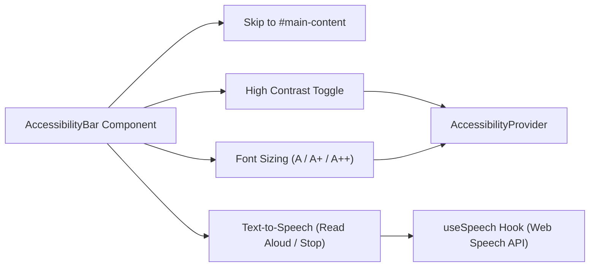

# UI Design System & Accessibility Specification

## 1. Design Philosophy & Accessibility Standards

The ScamShield user interface is built to serve all citizens, including elderly individuals, vulnerable victims under acute stress, and users with vision or motor impairments.

All user interfaces adhere strictly to **WCAG 2.1 Level AA** compliance:
- **Contrast Ratio:** Text and interactive elements maintain a minimum contrast ratio of 4.5:1 against backgrounds (7:1 in High Contrast mode).
- **Focus Indicators:** Interactive elements display a distinct high-visibility focus ring (`focus-visible:outline focus-visible:outline-3 focus-visible:outline-offset-2`).
- **Screen Reader Compatibility:** All controls carry semantic HTML5 tags, `aria-label`, `aria-describedby`, and live announcement regions (`aria-live="polite"`).
- **Cognitive Clarity:** Plain-language guidance, clear status badges, and deterministic step wizards prevent user confusion during fraud reporting.

---

## 2. Design Tokens & Color Palette

### 2.1 Core Institutional Palette
Tailwind theme extensions configured in `tailwind.config.ts`:

| Token | Hex Value | Semantic Usage |
|---|---|---|
| `gov-blue` | `#003366` | Primary buttons, headers, active navigation indicators |
| `gov-navy` | `#001f3f` | Dark accents, hover states on primary actions |
| `gov-red` | `#c0392b` | Error alerts, confirmed scam verdicts (RED), destructive actions |
| `gov-yellow` | `#f39c12` | Warning banners, suspicious verdicts (YELLOW), highlight badges |
| `gov-green` | `#27ae60` | Success banners, clean verdicts (GREEN), verified indicator badges |
| `gov-gray` | `#f4f6f8` | Page backgrounds, subtle containers |
| `gov-border` | `#d1d5db` | Standard form element and card borders |

### 2.2 High Contrast Mode Palette
Toggled via the AccessibilityBar and active when `html.high-contrast` is applied:

| Token | Hex Value | High-Contrast Usage |
|---|---|---|
| `high-bg` | `#000000` | True-black canvas |
| `high-fg` | `#ffffff` | Pure-white text |
| `high-yellow`| `#ffff00` | Primary interactive highlights and buttons |
| `high-cyan` | `#00ffff` | Hyperlinks and focus outlines |
| `high-green` | `#00ff00` | High-contrast success confirmations |
| `high-red` | `#ff3333` | High-contrast threat warnings |
| `high-border`| `#ffffff` | 2px solid white borders on all interactive controls |

---

## 3. Dynamic Font Scaling System

Users can adjust font scaling across the entire application without breaking layout geometries. The scaling factor is controlled through CSS custom properties defined in `src/index.css`:

```css
/* Standard (Default) */
:root {
  --a11y-font-xs: 0.75rem;
  --a11y-font-sm: 0.875rem;
  --a11y-font-base: 1rem;
  --a11y-font-lg: 1.125rem;
  --a11y-font-xl: 1.25rem;
  --a11y-font-2xl: 1.5rem;
  --a11y-font-3xl: 1.875rem;
}

/* Large Mode (+15%) */
html.font-scale-large {
  --a11y-font-xs: 0.875rem;
  --a11y-font-sm: 1rem;
  --a11y-font-base: 1.125rem;
  --a11y-font-lg: 1.25rem;
  --a11y-font-xl: 1.5rem;
  --a11y-font-2xl: 1.75rem;
  --a11y-font-3xl: 2.125rem;
}

/* Extra Large Mode (+30%) */
html.font-scale-xlarge {
  --a11y-font-xs: 1rem;
  --a11y-font-sm: 1.125rem;
  --a11y-font-base: 1.25rem;
  --a11y-font-lg: 1.5rem;
  --a11y-font-xl: 1.75rem;
  --a11y-font-2xl: 2rem;
  --a11y-font-3xl: 2.5rem;
}
```

---

## 4. Atomic Component Specifications

### 4.1 Button (`src/components/Button.tsx`)
- **Variants:** `primary` (navy blue), `secondary` (slate gray), `outline` (bordered blue), `danger` (crimson red), `ghost` (transparent).
- **Sizes:** `sm`, `md`, `lg`.
- **States:** Default, Hover, Active, Focus-Visible, Disabled, Loading (`aria-busy="true"` with animated spinner).
- **Keyboard Access:** Activated on `Enter` and `Space`.

### 4.2 Form Input (`src/components/Input.tsx`)
- **Accessibility Elements:**
  - Dedicated `<label>` linked via `htmlFor`.
  - Error states link error text via `aria-describedby="{id}-error"`.
  - `aria-invalid="true"` rendered whenever field validation fails.
  - Required fields indicated visually and via `aria-required="true"`.

### 4.3 Alert Banner (`src/components/Alert.tsx`)
- **Variants:** `info` (blue), `success` (green), `warning` (yellow), `error` (red).
- **Semantics:**
  - `role="alert"` and `aria-live="assertive"` for critical error alerts.
  - `role="status"` and `aria-live="polite"` for non-critical informational notices.
- **Iconography:** Distinct Lucide icons (AlertCircle, CheckCircle2, Info, AlertTriangle) ensure meaning is not conveyed by color alone.

### 4.4 Toast Notification (`src/components/Toast.tsx`)
- **Semantics:** `role="status"`, `aria-live="polite"`.
- **Behavior:** Fixed overlay at bottom-right of viewport, auto-dismissible after 4000ms with manual close button.

### 4.5 Modal Dialog (`src/components/Modal.tsx`)
- **Semantics:** `role="dialog"`, `aria-modal="true"`, `aria-labelledby="{id}-title"`.
- **Focus Management:** Focus trapped inside modal on open; returns focus to triggering element on close; closes on `Escape` key press.
- **Overlay:** Semi-transparent backdrop (`bg-slate-900/60`) with click-outside dismissal option.

---

## 5. AccessibilityBar & Text-to-Speech Architecture

The `AccessibilityBar` is mounted at the very top of both `PublicLayout` and `StaffLayout`:



- **Skip to Content Link:** Hidden off-screen by default; becomes visible on initial `Tab` press, jumping keyboard focus immediately to `<main id="main-content">`.
- **Text-to-Speech Engine:** Leverages browser `window.speechSynthesis`. When triggered, reads the main article or section text at 0.95x rate for clear diction. Toggling the button stops playback immediately.
