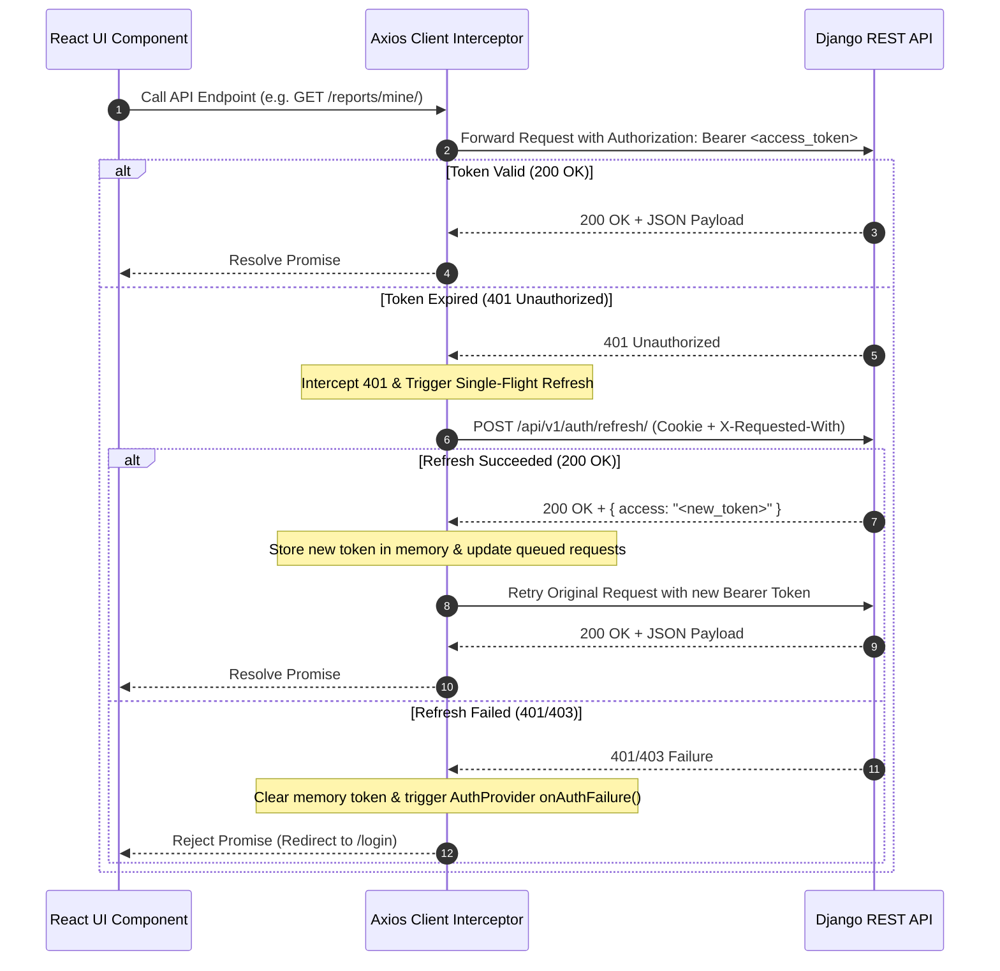

# API Contract Map & Client Architecture

## 1. Core API Client Setup

Frontend API communication is managed by a centralized Axios instance in `src/api/client.ts`.

- **Base URL:** `/api/v1` (via Vite proxy `http://127.0.0.1:8000` in dev; CloudFront edge in prod).
- **Credentials:** `withCredentials: true` ensures the 7-day HttpOnly `refresh` cookie is sent for token rotation.
- **In-Memory Access Token:** The 15-minute JWT access token is stored exclusively in process memory and never written to `localStorage` or `sessionStorage` (preventing persistent token theft via XSS).
- **Request Interceptor:** Automatically appends `Authorization: Bearer <token>` when a valid token exists in memory.
- **CSRF Mitigation:** Sensitive endpoints (`/auth/refresh/` and `/auth/logout/`) require the custom header `X-Requested-With: scamshield-web`.



---

## 2. Standard DRF Error Envelope Parser

All non-2xx responses from the backend follow the strict DRF custom error envelope:

```json
{
  "error": {
    "code": "validation_error",
    "message": "Invalid input provided.",
    "details": {
      "email": ["Enter a valid email address."],
      "financial_loss": ["Loss amount cannot be negative."]
    },
    "request_id": "c1f7a0b8-4c92-4f81-9b12-d81234567890"
  }
}
```

The error utility `src/api/errors.ts` exports `parseApiError(error: unknown): ParsedApiError` which parses Axios errors, extracts field-specific error details, captures the `request_id` for user support inquiries, and maps network errors cleanly without unhandled rejections.

---

## 3. Comprehensive Endpoint Inventory

Synced with `backend/openapi.yaml`:

### 3.1 Authentication & Profile (`/api/v1/auth/`)

| Method | Endpoint | Clearance | Request Body | Response Payload |
|---|---|---|---|---|
| `POST` | `/auth/login/` | Public | `{ email, password }` | `{ access, user: User }` + HttpOnly cookie |
| `POST` | `/auth/refresh/` | Public (Cookie) | Empty (`X-Requested-With` header) | `{ access, user: User }` |
| `POST` | `/auth/logout/` | Public (Cookie) | Empty (`X-Requested-With` header) | `204 No Content` |
| `GET` | `/auth/me/` | Authenticated | None | `User` |
| `POST` | `/auth/register/` | Public | `{ email, password, full_name }` | `201 Created` (`User`) |
| `POST` | `/auth/register/staff/` | Public | `{ email, password, full_name, role, organization, credential_note }` | `201 Created` (`User`, PENDING) |
| `POST` | `/auth/password/change/`| Authenticated | `{ current_password, new_password }` | `204 No Content` |

### 3.2 Scam Reports & Intelligence (`/api/v1/reports/`)

| Method | Endpoint | Clearance | Description |
|---|---|---|---|
| `GET` | `/reports/options/` | Public | Dropdown options for categories, platforms, payment methods, admin areas. |
| `POST` | `/reports/` | Public | Submit incident report (multipart with evidence files). Returns reference code, status, playbook, access key. |
| `POST` | `/reports/track/` | Public | Track anonymous report with `{ reference_code, access_key }`. |
| `GET` | `/reports/mine/` | Authenticated | Paginated list of submissions made by the logged-in user. |

### 3.3 Public Lookups & Alert Subscriptions (`/api/v1/lookups/` & `/alerts/`)

| Method | Endpoint | Clearance | Description |
|---|---|---|---|
| `POST` | `/lookups/` | Public | Query candidate indicator; returns RED / YELLOW / GREEN verdict and match records. |
| `POST` | `/alerts/subscriptions/` | Public | Subscribe to alerts via email/SMS for categories and audience groups. |
| `POST` | `/alerts/subscriptions/confirm/` | Public | Confirm subscription via token. |
| `POST` | `/alerts/subscriptions/unsubscribe/`| Public | Unsubscribe via token hash. |

### 3.4 Public Advisories & Literacy Hub (`/api/v1/advisories/` & `/guides/`)

| Method | Endpoint | Clearance | Description |
|---|---|---|---|
| `GET` | `/advisories/` | Public | Paginated list of published threat advisories. |
| `GET` | `/advisories/{id}/` | Public | Advisory details. |
| `GET` | `/guides/` | Public | Filterable list of published educational guides (`group`, `tactic`). |
| `GET` | `/guides/{slug}/` | Public | Full guide with sanitized markdown body and media assets. |

### 3.5 Spot the Scam Simulator (`/api/v1/simulator/`)

| Method | Endpoint | Clearance | Description |
|---|---|---|---|
| `POST` | `/simulator/attempts/` | Public | Initialize 5-scenario attempt; scenario answers are masked server-side. |
| `POST` | `/simulator/attempts/{id}/answers/` | Public | Submit decision for scenario (`is_scam`, `tactic`). |
| `POST` | `/simulator/attempts/{id}/complete/` | Public | Complete attempt; returns final score %, blind spots, and remediation guide links. |

### 3.6 Staff Triage Workbench (`/api/v1/triage/`)

| Method | Endpoint | Clearance | Description |
|---|---|---|---|
| `GET` | `/triage/queue/` | ANALYST, ADMIN | List pending reports ordered by risk score and cluster size. |
| `GET` | `/triage/reports/{id}/` | ANALYST, ADMIN | Detailed report cluster view with raw indicators and scan breakdown. |
| `GET` | `/triage/reports/{id}/evidence/`| ANALYST only | Generate 15-minute presigned S3 attachment download URLs. |
| `POST` | `/triage/reports/{id}/verify/` | ANALYST only | Verify cluster indicators and set threat level (`HIGH`, `MEDIUM`, `LOW`). |
| `POST` | `/triage/reports/{id}/reject/` | ANALYST only | Reject incident report with mandatory analyst rationale. |

### 3.7 Educator Literacy Studio (`/api/v1/studio/`)

| Method | Endpoint | Clearance | Description |
|---|---|---|---|
| `GET/POST`| `/studio/guides/` | EDUCATOR, ADMIN | Author and list educator-owned guides. |
| `PATCH/DELETE`| `/studio/guides/{id}/` | Author/ADMIN | Edit draft or delete draft guide. |
| `POST` | `/studio/guides/{id}/publish/` | Author/ADMIN | Publish guide to public hub. |
| `POST` | `/studio/guides/{id}/assets/` | Author/ADMIN | Upload multimedia asset (PDF, Audio, Image). |
| `GET/POST`| `/studio/scenarios/` | EDUCATOR, ADMIN | Author simulator scenarios with hotspot coordinates. |

### 3.8 Admin Portal (`/api/v1/admin-portal/`)

| Method | Endpoint | Clearance | Description |
|---|---|---|---|
| `GET` | `/admin-portal/users/` | ADMIN | List staff registration applications. |
| `POST` | `/admin-portal/users/{id}/approve/` | ADMIN | Approve pending staff application. |
| `POST` | `/admin-portal/users/{id}/reject/` | ADMIN | Reject staff application with reason. |
| `GET/POST`| `/admin-portal/rules/` | ADMIN | View and edit heuristic scanner rules. |
| `GET/PATCH`| `/admin-portal/scanner-config/`| ADMIN | Configure scoring thresholds and ruleset version. |
| `GET` | `/admin-portal/audit-logs/` | ADMIN | Query tamper-evident system audit logs. |
| `GET` | `/admin-portal/telemetry/metrics/` | ADMIN | CloudWatch system health and volume charts. |
