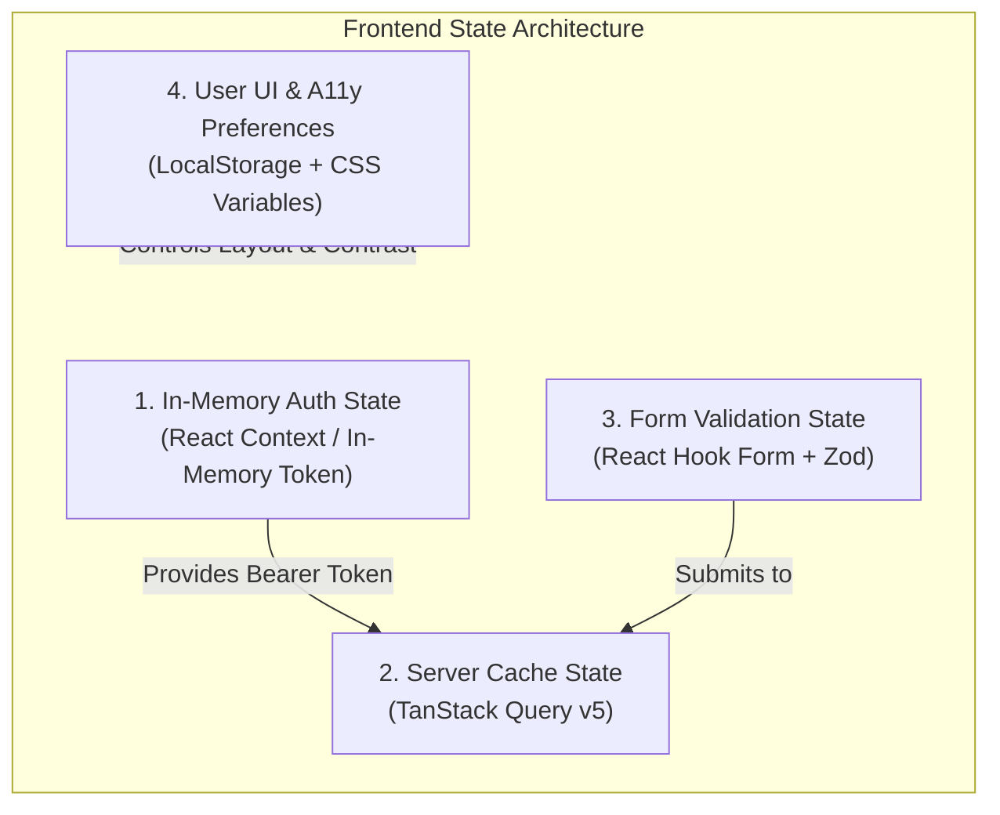

# Frontend State Management Architecture

## 1. State Taxonomy Overview

The ScamShield frontend divides state into four distinct, strictly separated tiers:



| State Tier | Technology | Lifetime / Persistence | Description |
|---|---|---|---|
| **Auth State** | `AuthProvider` (React Context) | Process Memory only | Current `user`, `role`, and 15-min JWT access token. Re-hydrated on load via silent cookie refresh. |
| **Server Cache State** | TanStack Query (`@tanstack/react-query`) | Runtime Cache | Remote backend data (triage queues, incident options, published guides, telemetry). |
| **Form State** | `react-hook-form` + `zod` | Component Lifecycle | Form inputs, dirty state, field errors, and schema validation. |
| **A11y Preferences** | `AccessibilityProvider` | LocalStorage | User-selected High Contrast mode (`true/false`) and font scaling tier (`normal`, `large`, `xlarge`). |

---

## 2. In-Memory Authentication Lifecycle (`AuthProvider.tsx`)

### 2.1 Security Model
- **No LocalStorage Tokens:** To prevent access token theft via cross-site scripting (XSS), the JWT access token is stored exclusively in module memory via `setAccessToken()` in `src/api/client.ts`.
- **HttpOnly Refresh Cookie:** The browser automatically manages the 7-day refresh token in a secure, SameSite=Lax cookie at path `/api/v1/auth/`. JavaScript cannot read or modify this cookie.

### 2.2 App Bootstrap Flow
1. When `AuthProvider` mounts, it invokes `refreshSession()`:
   ```ts
   POST /api/v1/auth/refresh/ (withCredentials: true, X-Requested-With: scamshield-web)
   ```
2. If an active refresh cookie is present:
   - Backend returns `{ access: "<jwt_token>", user: { ... } }`.
   - Access token is stored in module memory.
   - User profile is loaded into context state.
   - `isAuthenticated` becomes `true`.
3. If no session exists (401 response):
   - Auth state clears gracefully without showing error banners.
   - User remains anonymous/public.
   - `isLoading` transitions to `false`.

### 2.3 Single-Flight Refresh Synchronization
If multiple API queries trigger simultaneously when the access token expires:
- The first 401 response sets `isRefreshing = true` and calls `/auth/refresh/`.
- All subsequent 401s are placed in `failedQueue`.
- Once the refresh completes, all queued requests are replayed with the new Bearer token.
- If refresh fails, `onAuthFailureCallback()` triggers and redirects the user to `/login`.

---

## 3. Server State Architecture (TanStack Query)

### 3.1 Standard Query Client Configuration
Configured in `src/App.tsx`:
```ts
const queryClient = new QueryClient({
  defaultOptions: {
    queries: {
      staleTime: 60 * 1000, // 1 minute fresh cache
      retry: (failureCount, error: any) => {
        // Never retry 401/403 authorization failures
        if (error?.status === 401 || error?.status === 403) return false;
        return failureCount < 2;
      },
      refetchOnWindowFocus: false,
    },
  },
});
```

### 3.2 Canonical Query Key Hierarchy

```ts
export const queryKeys = {
  auth: {
    me: ['auth', 'me'] as const,
  },
  reports: {
    all: ['reports'] as const,
    options: ['reports', 'options'] as const,
    mine: (page: number) => ['reports', 'mine', { page }] as const,
    detail: (id: string) => ['reports', 'detail', id] as const,
  },
  triage: {
    queue: (filters: Record<string, any>) => ['triage', 'queue', filters] as const,
    report: (id: string) => ['triage', 'reports', id] as const,
  },
  guides: {
    list: (filters: { group?: string; tactic?: string }) => ['guides', 'list', filters] as const,
    detail: (slug: string) => ['guides', 'detail', slug] as const,
  },
  simulator: {
    attempt: (id: string) => ['simulator', 'attempt', id] as const,
  },
  admin: {
    users: (status?: string) => ['admin', 'users', { status }] as const,
    rules: (ruleType?: string) => ['admin', 'rules', { ruleType }] as const,
    scannerConfig: ['admin', 'scanner-config'] as const,
    telemetry: (range: string) => ['admin', 'telemetry', { range }] as const,
  },
};
```

---

## 4. Form State & Schema Validation (`react-hook-form` + `zod`)

Forms decouple render lifecycles from input changes using uncontrolled inputs registered via `react-hook-form`.

### Example: Report Submission Schema
```ts
import { z } from 'zod';

export const reportFormSchema = z.object({
  category: z.enum([
    'PHISHING',
    'INVESTMENT',
    'E_COMMERCE',
    'JOB',
    'LOAN',
    'IMPERSONATION',
    'LOVE_ROMANCE',
    'OTHER',
  ]),
  platform: z.enum([
    'WHATSAPP',
    'TELEGRAM',
    'SMS',
    'FACEBOOK',
    'INSTAGRAM',
    'TIKTOK',
    'EMAIL',
    'PHONE_CALL',
    'WEBSITE',
    'OTHER',
  ]),
  message_text: z
    .string()
    .min(10, 'Please provide at least 10 characters describing the incident.')
    .max(5000, 'Narrative cannot exceed 5,000 characters.'),
  financial_loss: z
    .string()
    .regex(/^\d+(\.\d{1,2})?$/, 'Enter a valid monetary amount.')
    .default('0.00'),
  currency: z.enum(['MYR', 'NPR', 'USD']).default('MYR'),
  payment_method: z.enum([
    'BANK_TRANSFER',
    'CREDIT_DEBIT_CARD',
    'E_WALLET',
    'CRYPTOCURRENCY',
    'GIFT_CARD',
    'CASH',
    'NONE',
  ]),
  is_anonymous: z.boolean().default(false),
});
```

---

## 5. Accessibility State Management

The `AccessibilityProvider` manages user display preferences:
1. **High Contrast:** Stored in `localStorage` under `scamshield_a11y_contrast`. Toggling adds or removes `.high-contrast` on `document.documentElement`.
2. **Font Scaling:** Stored in `localStorage` under `scamshield_a11y_scale`. Applies `.font-scale-large` or `.font-scale-xlarge` on `document.documentElement`.
3. **Screen Reader Live Announcements:** A hidden live region (`aria-live="polite"`, `role="status"`) renders temporary string announcements for visual state changes (such as "Submitting report", "Speech stopped").
