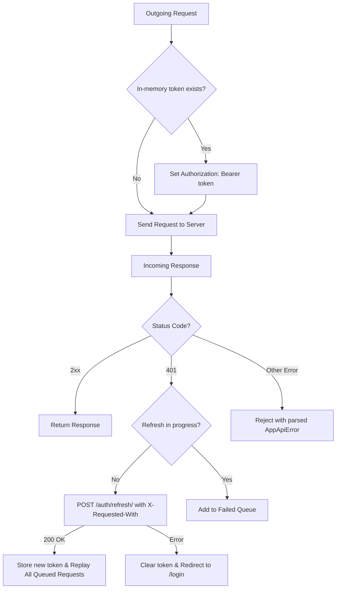

# 4. State Management & Query Cache

## 1. Global Auth State Architecture

Managed via `AuthProvider` (`src/auth/AuthProvider.tsx`):

```ts
interface AuthContextValue {
  user: User | null;
  role: UserRole | null;
  accessToken: string | null; // In-memory ONLY
  isAuthenticated: boolean;
  isLoading: boolean;
  login: (credentials: LoginCredentials) => Promise<User>;
  logout: () => Promise<void>;
  refreshSession: () => Promise<void>;
}
```

- **Memory Boundary:** The `accessToken` is stored strictly in memory and injected via Axios request interceptors.
- **Refresh Flow:** On 401 or app mount, calls `POST /api/v1/auth/refresh/` with `X-Requested-With: scamshield-web` and `withCredentials: true`.
- **Fail-Safe:** If refresh fails, tokens are wiped, state reverts to unauthenticated, and user is redirected to `/login`.

---

## 2. TanStack Query Cache Structure

The frontend standardizes cache keys to ensure deterministic cache hits, invalidation, and background refetching:

| Cache Key Pattern | Target Data | Invalidation Event |
|---|---|---|
| `['triage-queue', filters]` | Analyst pending triage queue | On indicator verification or report rejection |
| `['triage-report', id]` | Single report investigation cluster | On indicator verify/reject |
| `['guides', { group, language, tactic }]` | Public literacy guides list | On guide publish/archive in studio |
| `['guide-detail', slug]` | Individual guide markdown and assets | When guide is modified |
| `['simulator-attempt', id]` | Active simulator exercise session | When answer is submitted |
| `['audit-logs', { severity, dateRange }]`| Admin immutable audit log table | Auto-refreshed or filtered |
| `['reports-mine', page]` | Citizen submission history | When new report is submitted |

---

## 3. Axios Interceptor Architecture

Configured in `src/api/client.ts`:


