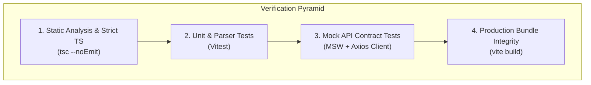

# Frontend Testing & Security Architecture

## 1. Security Architecture & Threat Defenses

The ScamShield frontend is engineered in strict compliance with the project's security rules (Section 30 and Rules R-A1 through R-D5).

### 1.1 In-Memory Token Isolation (Anti-XSS Rule 30)
- **Zero Tokens in Browser Storage:** The JWT access token (15-minute validity) is held strictly in JavaScript heap memory inside `src/api/client.ts`. It is never written to `localStorage`, `sessionStorage`, or indexedDB.
- **Revocable HttpOnly Refresh Cookie:** The refresh token resides in a browser cookie marked `HttpOnly`, `Secure`, `SameSite=Lax`, and restricted to `Path=/api/v1/auth/`. Malicious scripts executed via potential XSS vectors cannot read, export, or transmit this token.

### 1.2 Cross-Site Request Forgery (CSRF) Mitigation
- All sensitive cookie-bearing endpoints (`/auth/refresh/` and `/auth/logout/`) enforce the custom request header:
  ```http
  X-Requested-With: scamshield-web
  ```
- Because cross-origin HTML `<form>` submissions cannot attach custom HTTP headers without triggering a preflight CORS check (which ALB/CloudFront rejects), CSRF exploitation is completely blocked.

### 1.3 Content Security Policy (CSP) & Markdown Sanitization
- Guide content authored in the Literacy Studio is sanitized on the backend using Python `nh3` before transmission.
- The frontend renders markdown using safe parsers that strip inline script tags, `onerror` attributes, and `javascript:` URLs.
- Raw HTML is never injected using `dangerouslySetInnerHTML`.

### 1.4 Evidence Vault Access Controls
- Evidence screenshots and documents stored in private S3 buckets are never publicly addressable.
- Analysts only access evidence files through 15-minute time-limited pre-signed S3 URLs (`/triage/reports/{id}/evidence/`) returned with `ResponseContentDisposition="attachment"`.
- Citizens and educators cannot request presigned evidence URLs under any condition.

### 1.5 Victim Privacy & Indicator Masking
- Responses from the public lookup and tracking endpoints deliberately strip sensitive victim data (personal narrative, reporter identity, financial balance).
- Bank account indicators display exclusively in masked format (e.g. `****1234`).

---

## 2. Frontend Testing Strategy

The testing suite leverages **Vitest**, **MSW (Mock Service Worker)**, and strict TypeScript compilation:



### 2.1 Static Typing Gate (`tsc --noEmit`)
Every build must pass TypeScript compilation with 0 warnings or errors under the strictest configuration:
- `"strict": true`
- `"noUnusedLocals": true`
- `"noUnusedParameters": true`
- `"noFallthroughCasesInSwitch": true`

### 2.2 Unit Testing (`vitest`)
Focused on critical client-side business logic and failure degradation:
- **Error Parser Tests (`src/api/errors.test.ts`):** Validates extraction of standard DRF error envelope fields (`code`, `message`, `details`, `request_id`), network failure handling, and HTTP status codes.
- **Speech Synthesis Fallbacks:** Verifies that environments without the Web Speech API fail gracefully without throwing runtime errors.
- **A11y Preferences:** Tests that high-contrast and font-scaling classes sync reliably with `localStorage`.

### 2.3 Mock Service Worker (MSW) Handlers
MSW intercepts network calls at the network boundary, simulating backend responses for:
- Silent session bootstrap on app mount (`POST /api/v1/auth/refresh/`).
- Single-flight 401 refresh queuing and retry mechanisms.
- Report submission and validation error handling.

---

## 3. Accessibility & Usability Testing Standards

Before any slice is marked complete, it must verify:
1. **Keyboard-Only Navigation:** Full application flow navigable via `Tab`, `Shift+Tab`, `Enter`, `Space`, and `Escape`.
2. **Focus Visibility:** Active element displays high-visibility focus ring (`focus-visible:outline-3`).
3. **Screen Reader Live Regions:** Dynamic loading, errors, and announcements announce clearly via `aria-live="polite"` or `assertive`.
4. **Color Contrast:** WCAG 2.1 AA compliant contrast ratio >= 4.5:1 across all components; >= 7:1 in High Contrast mode.

---

## 4. Verification Gate Commands

Run from the `frontend/` directory:

| Command | Objective | Passing Criteria |
|---|---|---|
| `npx tsc --noEmit` | Strict Type Checking | 0 errors |
| `npx vitest run` | Unit & Contract Tests | All test suites passing |
| `npm run build` | Production Bundle Check | Clean bundle in `dist/` with zero missing chunks |
